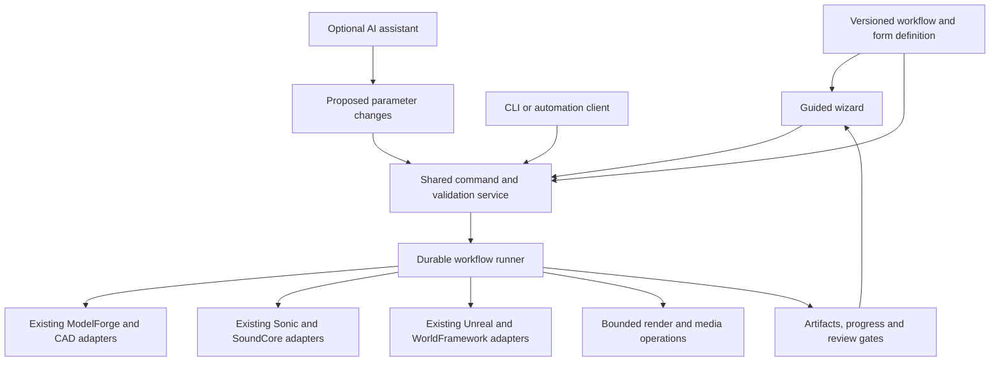

# GameCore desktop hub and guided workflow design

Date: 2026-11-05. Status: proposed implementation design, not an implemented app. Extends [the Forge roadmap](GAME_STUDIOS_GAP_REVIEW_2026-11-05.md) and [30-template library](GAME_STUDIOS_CREATIVE_WORKFLOW_TEMPLATES.md).

## Product decision

Build a dedicated **GameCore Tauri desktop hub** as the user-facing orchestration entry point. A person should be able to choose a supported workflow, select assets, adjust a few settings, preview, run, review and export without writing code, using a terminal or maintaining an AI conversation. AI may suggest inputs or explain problems, but must not be required for routine execution of a workflow advertised as no-AI.

The hub coordinates existing applications rather than replacing their editors. ModelForge remains the model library/editor; Sonic Alchemist owns audio creation; SoundCore owns audio assets; CAD owns exact geometry; Unreal/OpenWorld and WorldFramework retain engine operations and validation. A template can include an explicit handoff to one of those apps, but must identify it before the user starts.

Proposed stack: Tauri 2, React/TypeScript UI, a Rust workflow/application service and local durable run storage. This is consistent with the inspected ModelForge and SoundCore Tauri projects. Tauri supports a web frontend with a Rust application boundary; frontend calls can use typed Rust commands. The specific module layout and persistence choices below are design recommendations, not requirements imposed by Tauri. [Tauri architecture](https://v2.tauri.app/concept/architecture/), [calling Rust](https://v2.tauri.app/develop/calling-rust/).

Start on Windows. Keep the hub in a new `hub/` directory under GameCore, separate from existing Godot `autoload/`, `scripts/`, `addons/` and `project.godot`. Preserve legacy engine paths and behavior. Do not create an unrelated duplicate repository or relocate the existing tools as part of the first implementation.

## One workflow, several ways to run it



The UI and agent must submit the same typed operations through the same validators. They share workflow version, resolved plan, provider job IDs, evidence and recovery. AI-generated text is not an execution plan until parsed into supported fields, validated and accepted. No workflow may require an LLM to choose the next routine step, interpret a tool's success or synthesize shell commands.

A proposed package layout:

```text
hub/
  src/                     project browser, wizard, queue and review UI
  src-tauri/               desktop lifecycle and typed UI commands
  crates/workflow-core/    plans, validation, state machine, receipts
  crates/workflow-adapters/ provider clients and bounded process runners
  tests/                   runner, adapter and native UI fixtures
```

Keep existing playbooks in `workflows/`. Add versioned executable definitions and form metadata alongside them only when implemented and validated. These paths are proposed; no scaffold is created by this document.

## Assistance levels must be explicit

| Label | Meaning | Required fallback |
|---|---|---|
| No AI required | Presets, supplied assets and deterministic operations cover the advertised task. No model API key or LLM call is needed. | Forms, library search, editable cue tables and ordinary error messages. |
| Optional AI help | AI can propose settings, search terms, shot lists, text or explanations. The same workflow can be completed manually. | Reject/dismiss suggestions and continue without losing inputs. |
| AI generation required | A chosen step intentionally generates novel material using an AI model. | Offer a supplied-file/preset alternative where available, or clearly label the workflow as AI-dependent. |

Offline operation is a separate capability: no-AI does not mean that first-time dependency installation or catalog download needs no network. Test a prepared local workflow without internet after prerequisites and assets are installed. Hardware/runtime readiness is also separate from assistance level.

Avoid promising no-AI creation of arbitrary new scenes or scores. The first video wizard covers supported scene/action presets, supplied models/music and parameterized rendering. Bespoke animation, complex composition or unsupported adapters must appear as explicit editor handoffs or unavailable branches—not hidden “ask an agent” requirements.

## Hub navigation

| Area | User purpose |
|---|---|
| Projects | Create/open a project, locate missing folders, choose engine/platform, view recent runs and pinned dependencies. |
| Workflows | Browse templates by outcome; see previews, inputs, required apps, assistance level, manual steps and implementation maturity. |
| Run wizard | Fill settings, select assets, preview, inspect readiness and start a saved plan. |
| Jobs | Follow progress, elapsed time, provider state and resource waiting; cancel or resume supported steps. |
| Review | Play video/audio, compare images/versions, enter human decisions and see failed technical checks. |
| Assets | Search provider catalogs and select exact versions; open the owning editor. Do not mirror catalog databases. |
| Connections | Locate apps/executables, test endpoints, configure paths and repair missing dependencies without a terminal. |
| Templates | Save a reusable preset, duplicate/fork a workflow and inspect version changes. Advanced authoring stays separate from everyday use. |

Use ordinary task language in forms. Show technical paths, schemas and logs in expandable details. Support keyboard navigation, visible focus, labeled fields, inline errors, progress announcements and non-color-only statuses. Let users save drafts before all dependencies are available.

## First wizard: logo sting from the captured production

Use the existing [guide](../workflows/logo-sting-video/README.md) and [production record](../workflows/logo-sting-video/example.md), extending their production-record and cue-sheet contracts rather than creating an incompatible format.

| Step | User sees and does | Deterministic behavior / gate |
|---|---|---|
| 1. Choose project and recipe | Pick logo sting, output folder and a supported animation preset. | Resolve template version and required tools. Describe scope and editor handoffs before starting. |
| 2. Select subject and branding | Pick an exact ModelForge version or supplied scene; enter approved title and end-card text; select a font. | Validate assets, dependencies, source pins and font/license references. Preserve the historical Foundry example; do not silently reuse its wording. |
| 3. Set the look | Choose camera/light/background presets and simple appearance options. | Generate quick representative frames; supported options are typed parameters, not script edits. |
| 4. Set motion and timing | Choose duration/speed, supported action preset and inspect a cue timeline. | Derive a consistent frame count from rational FPS; show any rounding. Recompute source-to-output cue mapping when timing changes. |
| 5. Add music and effects | Choose supplied music, a licensed preset score, or an explicit Sonic editing handoff; select/audition effects. | Bind exact source IDs; render approved score recipes and Foley deterministically. Save music/SFX stems. Generic new composition is not promised without an adapter/preset. |
| 6. Preview and adjust | Play a low-cost preview; edit cue placement, mix and end-card layout. | Record preview revision; changes invalidate affected checks. Do not treat a contact sheet or waveform as audio approval. |
| 7. Check and render | See required apps, actual device, output size estimate and any blockers; press Render. | Check Blender/device, fonts, audio assets, FFmpeg/FFprobe and writable destination. Estimates show uncertainty; unsupported hardware offers an explicit tested fallback, never a silent switch. |
| 8. Review and export | Play the final output, complete visual/audio/copy review and save the delivery package. | Check frames/streams/duration/decode; preserve staged outputs, sources, stems, cue sheet and receipt. Technical completion and creative acceptance remain separate. |

The current production is script-driven and requires code edits for changes. The wizard needs parameterized adapter implementations before the forms can honestly execute those choices. Do not expose a decorative wizard whose last step tells the user to edit Python or ask an AI.

## Wizard metadata added to every template

Retain the template/binding/run separation already defined in the starter library. Add:

- Input types, defaults, units, ranges, required conditions and dependencies; render-friendly presets with an advanced override where supported.
- Form sections and widget hints: provider asset picker, local file/folder picker, camera preset, color, bounded numeric field, shot list, cue table and audio audition.
- Capability requirements and a visible readiness reason for each unavailable option.
- Assistance level per workflow and step; a concrete manual/preset alternative for optional AI suggestions.
- A preview operation and the fingerprint of inputs it evaluated; stale previews are visibly marked.
- Change-impact metadata so Back/Edit explains which outputs must be regenerated.
- Human review controls, artifact viewers and export choices; review decisions bind to exact artifact revisions.
- Example fixture, expected outputs, failure recovery and a completed no-AI acceptance receipt before a no-AI badge is published.

Illustrative fragment—not an executable schema or existing API:

```json
{
  "template_id": "forge.video.logo-sting",
  "template_version": "0.1.0",
  "implementation_status": "proposed",
  "assistance": {"ai_required": false, "offline_after_setup": true},
  "wizard": {
    "steps": [
      {"id": "branding", "title": "Choose your logo and wording", "fields": ["model", "end_card_title"]},
      {"id": "delivery", "title": "Choose the output", "fields": ["fps", "frame_count"]}
    ],
    "fields": {
      "model": {"type": "asset_reference", "provider": "modelforge", "required": true},
      "end_card_title": {"type": "string", "max_length": 80, "required": true},
      "fps": {"type": "enum", "values": ["24/1"], "default": "24/1"},
      "frame_count": {"type": "integer", "minimum": 24, "maximum": 720, "default": 256}
    }
  },
  "acceptance": {"no_ai_run": "not_run", "clean_machine": "not_run"}
}
```

The illustrated bounds describe a bounded starter proposal, not renderer limits. An AI-free score choice must actually resolve to supplied audio or a deterministic implemented preset. Validate form and backend constraints from the same source to prevent UI/runner drift.

## Durable execution and ordinary-user recovery

Persist run state in a local database; retain portable project bindings and receipts in project-owned files. Use transactional updates and unique run/step/output IDs. Persist provider job IDs before polling or reconciling. After restart, distinguish still-running provider work, interrupted local work, completed output awaiting confirmation and failed work.

Suggested step states: `pending`, `ready`, `running`, `waiting_for_review`, `completed`, `failed`, `cancelled`, `blocked`. Check outcomes remain `passed`, `failed`, `blocked`, `not_run`. A technical step can finish while its artifact still awaits human acceptance. Do not put a generated score into an approved state merely because a file exists.

For the first release, background persistence after closing the hub is not a promise. Show active jobs before exit, offer to keep the hub open/minimized or safely stop owned local workers, and retain resumable records. Provider jobs that outlive the UI must be reconciled by job ID on reopen. A separately managed background service can be evaluated later; a database alone does not keep processes alive.

Use provider APIs/MCP and typed process arguments. Never interpolate user-entered shell text or invent a second Unreal MCP transport. Launch only registered tools and manage only owned processes. Reuse existing credentials/settings via explicit connections; no credentials in templates, receipts or frontend logs. Template installation must not silently grant arbitrary code execution; provider adapter packages are trusted code with a separate installation/update boundary.

The repair UI should offer concrete actions: Locate missing file, Open tool, Reconnect, Retry failed step, Rebuild affected outputs, Choose compatible preset, or View details. Explain what will be preserved. Back/Edit keeps completed outputs and invalidates only affected descendants; never overwrite source media or user review saves.

## Apply the wizard contract to all 30 templates

| Template family | IDs | Shared controls | Principal limitation to expose |
|---|---|---|---|
| Presentation and video | T01–T10 | Asset/shot pickers, camera/look presets, timing, cards/captions, output variants | Unsupported custom animation or capture routes require an explicit editor/consumer handoff. |
| Sound and music | T11–T20 | Audio audition, source/recipe pickers, cue/state tables, mix/profile settings, publication | Adaptive runtime adapters and broad Sonic command coverage remain roadmap work; recording requires the person's explicit action. |
| Asset creation and review | T21–T26 | Source search, CAD dimensions, material/LOD profiles, rig/clip selection, evidence viewer | Do not infer missing rig, collision or engine compatibility from successful preview. |
| Game iteration and reuse | T27–T30 | Consumer/version selection, fixture/route profiles, baseline comparison, capture-to-template form | Builds and acceptance remain engine-specific; arbitrary historical scripts cannot automatically become safe executable templates. |

Each template starts as a guided definition. Only promote the implemented subset after actual no-AI and recovery tests. Covering all IDs in a table is not implementation evidence.

## Implementation sequence

1. **Foundation, alongside GC-01/03:** typed commands, versioned plans, adapter boundaries and durable receipts designed for UI and CLI parity from the start.
2. **Hub shell:** Windows Tauri app, project/workflow browser, connections and saved wizard drafts. Do not run every specialized editor at startup.
3. **Small execution pilot:** T02 turntable with existing/supplied model and optional supplied audio. Verify real progress, cancellation, restart and delivery.
4. **Captured video pilot:** T01/T11 using the logo production's parameterized render, score and card adapters. Save presets; then run a distinct second subject.
5. **Expansion:** T20 library handoff and T26 review submission; then T06 trailer and other templates as adapters become ready. Add optional AI suggestions only after the manual path works.

Although rollout is recorded as Phase 6, the UI-independent runner and form contracts must be included in earlier phases. Do not postpone schema design until all 30 workflows have separate scripts.

## Acceptance criteria

- On a clean supported Windows machine, complete setup, choose a supported template, supply inputs and deliver its output without a terminal, source edits, LLM account or AI calls.
- On the prepared machine with network access disabled, complete the supported local fixture; explicitly list any workflow branches that require online assets/services.
- Run identical pinned inputs through wizard and CLI; compare resolved plans, validation and declared output tolerances. Bit-identical rendering is required only where the toolchain actually supports it.
- Missing dependencies and unsupported choices are identified before expensive work. No silent fallback or fabricated success.
- Cancel/restart during a render, disconnect after publication and reopen during pending review; retain outputs, reconcile jobs and avoid duplicate assets.
- Change only card text, then only audio, then timing; verify the expected invalidation and reuse. Invalidated reviews cannot remain approved for new artifacts.
- A user can navigate by keyboard, understand field errors, view progress and recover from failures without AI explanation.
- Test with at least three people unfamiliar with the workflow: record completion, assistance requested and unclear screens. Any required intervention becomes a usability issue rather than an assumed success.
- Optional AI suggestions show a proposed change that can be accepted, edited or rejected; rejecting a suggestion leaves the non-AI workflow fully usable.

These are proposed acceptance tests. No hub binary, UI prototype or wizard execution was built or tested in this documentation update.
