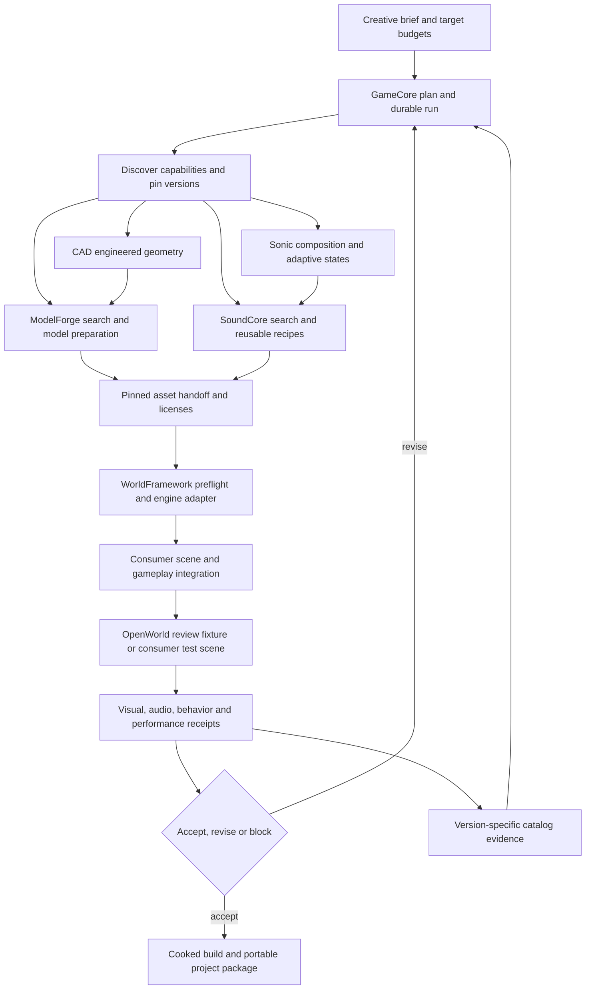

# AreCore Forge: repository gaps and game development roadmap

Reviewed: 2026-11-05. Status: implementation proposal based on local source inspection, with selected checks executed. Primary workflow: `game-project-integration`; primary dimension: 3D; initial delivery target: Windows/Unreal. Godot support is a separate acceptance track.

## Decision

The individual tools provide substantial foundations. The highest-value next investment is a durable GameCore workflow runner, shared versioned handoff contracts, and one reproducible playable slice. Building another asset catalog, another Unreal MCP transport, or another audio editor would duplicate work already present.

The website's strongest implementation gap is **GameCore as an orchestration hub**. Its current integration command validates local files and consumer declarations, not live service readiness or cross-tool execution. **Adaptive music authoring exists** in Sonic Alchemist, but an engine runtime, gameplay parameter bridge and full application agent interface remain unfinished. **OpenWorld review and performance tools exist**; the missing work is broader repeatable test coverage, portable consumer adapters and reliable promotion gates, rather than a sandbox from scratch.

Use this document as a prioritized backlog, not as a completion certificate. All implementation items below remain proposed unless explicitly described as existing. No application code, assets, saves, service settings or website claims were changed during this review.

## Scope and evidence boundary

Reviewed the active development folders under `X:/Projects`, including uncommitted source. GameCore and Sonic Alchemist have significant local work; treating HEAD alone as their implementation would omit real capabilities. OpenWorld and WorldFramework are local project folders without Git metadata. The companion [source snapshot](GAME_STUDIOS_GAP_REVIEW_2026-11-05.evidence.json) records selected file hashes and repository state so the findings can be revisited.

| Repository | Local HEAD at review | Working tree / review scope |
|---|---|---|
| ArcoreGameCore | `cdd5732` | Modified and untracked integration, taxonomy and framework work included; selected entry points, contracts and legacy audio inspected. |
| ArcoreModelForge | `ae2d8f5` | Clean at initial inspection; catalog/MCP routing, Blender job lifecycle and quality checks inspected. |
| ArcoreSonicAlchemist | `96c5b00` | Modified and untracked audio/UI work included; adaptive authoring, repair MCP, SoundCore integration and capture publishing inspected. |
| ArcoreSoundCore | `098a541` | Clean at initial inspection; workflow dispatcher, capability schemas, publishing/recipe tests and agent contracts inspected. |
| ArcoreCAD | `88efd8b` | Clean at initial inspection; geometry command schemas, export paths and shared API/MCP architecture inspected. |
| ArcoreOpenWorld | No Git metadata | Review/sandbox implementation and runbooks, performance analyzers and existing optimization evidence inspected. |
| ArcoreWorldFramework | No Git metadata | Integrity/adapters/profile boundaries and source test suites inspected. |
| Website | `f9d23c6` | Game Studios page, tool descriptions and example diagram are the claim baseline. |

This is a targeted cross-repository implementation audit, not an exhaustive line-by-line review. No remote synchronization was performed on these development repositories; findings describe the local snapshot, not every remote branch. No engine, GPU workload, audio recording, live MCP mutation or production asset approval was executed. Runtime and installer acceptance remains **not_run** for this audit. A function or existing test is source evidence, not proof that the current desktop binary contains or successfully executes it.

## Claims versus implementation

| Website proposition | Evidence found | Gap / present interpretation |
|---|---|---|
| Forge is a framework and collection of tools for accelerated AI-assisted game development | GameCore workflow catalog, engine-neutral contracts, WorldFramework validation/runtime package and working tool-specific automation. [G1], [W1] | Collection/framework positioning is supported by source. No common released Forge distribution or measured cross-tool acceleration baseline was established. Define a compatible version set and benchmark an end-to-end slice. |
| GameCore coordinates specialized tools and AI-assisted tasks | Ecosystem registry, read-only `inspect()` checker, review registry and manual porting CLI. [G1], [G2] | **Partial.** No durable execution runner found in the inspected GameCore entry points. Registry omits Sonic Alchemist and CAD. A passing file check does not establish connectivity, execution, recovery or orchestration. |
| Sonic Alchemist produces music, sound and adaptive scores | Adaptive `Design`, validated states/layers, sample-clock transitions, audition/save/load/export; native audio and repair tools. [A1], [A2] | **Authoring implemented in source; game integration partial.** Handoff is aligned WAVs plus JSON, with explicit manual XJ reconstruction. Runtime game parameters, engine adapter and broad MCP/API remain open. |
| ModelForge supports quick modeling, inventory and cataloging | Model search/versioning, direct editing, Blender tools, asynchronous job IDs, quality evidence and design iterations. [M1], [M2] | **Implemented foundations.** Finish durable restart recovery and pinned downstream handoffs. Do not mislabel existing job polling, cancel, decimation or UV tools as absent. |
| SoundCore catalogs, filters and transforms sound assets | Keyword filters, edit recipes, previews/renders, derived asset publication, project manifests and acknowledged handoffs. [S1], [S2] | **Implemented foundations.** Semantic similarity is not supplied by keyword search. Editing depends on FFmpeg; shared contracts and consumer adoption remain incomplete. |
| MCP layers let agents drive tools and reuse workflows | ModelForge MCP; SoundCore MCP recipes/workflow resources; CAD MCP using the same API as desktop; Sonic repair MCP; Epic native Unreal MCP. [M1], [S1], [C1], [A3], [O1] | **Uneven coverage.** Repair MCP is not full Sonic desktop control; per-tool recipes are not a cross-tool resumable run. Reuse existing transports and add orchestration above them. |
| CAD produces realistic engineered 3D models | Parametric solids/sketches/booleans, units, transactional revisions, STEP/STL/GLB exports and geometry checks. [C1] | **Geometry foundation supported.** Physical-looking engineered geometry is not automatically a textured, collision-ready, budgeted game asset. Add a ModelForge/Blender finishing handoff. |
| OpenWorld supports subjective review and simulated/stress performance environments | Version-pinned review island, sandbox layouts, close-orbit capture, raw angular timing and runtime telemetry. [O1], [O2] | **Scoped support.** Existing fixtures include static proxies and a terrain-following observation camera. They do not establish collision, autonomous simulation, animated motion clearance or shipping performance. Expand test scenarios and measurements. |
| Pipeline returns review findings to planning and reusable catalogs | OpenWorld append-only review evidence, ModelForge version-specific quality and SoundCore review/publishing endpoints. [O1], [M2], [S1] | **Building blocks exist.** No verified GameCore end-to-end closed loop was established. Preserve separate human, functional, visual, audio and performance decisions. The website correctly labels its diagram as an example. |

## Recommended architecture

GameCore should own project/workflow orchestration and receipts. ModelForge and SoundCore remain the authorities for their catalogs. Sonic owns composition and audio processing. CAD owns exact geometry. WorldFramework owns reusable validation and engine adapters. OpenWorld owns reference fixtures and project evidence. A consuming game owns gameplay, import destinations and final acceptance.

The following diagram is a **proposed execution architecture**, not a description of an already automated pipeline. Existing integrations supply many nodes; the durable runner, normalized receipts and complete feedback loop are the principal new work.

Do not add another Unreal MCP server or arbitrary scripting bridge. Use Epic's native server and the existing ModelForge bridge. Serialize editor writes, pin project identity, and reuse provider job IDs. Schedule scarce GPU/render work centrally while allowing independent read-only checks to proceed.

## Prioritized implementation backlog

Priority: **P0** closes a central claim or blocks a trustworthy first pipeline; **P1** makes iteration repeatable and efficient; **P2** broadens capability after the first slice. Effort is relative: S = contained change, M = multi-module work, L = cross-repository/runtime work. These are planning estimates, not delivery promises. Owners are repository responsibilities, not assigned people.

### GameCore and shared contracts

**GC-01 — P0 / L: durable workflow execution.** Owner: GameCore. Existing `tools/ecosystem.py` deliberately performs only file checks [G1]. Add a typed step graph with inputs/outputs, dry-run planning, dependency validation, persisted run/step states, provider job references, timeout/cancel, explicit retries and resume. Use idempotency where providers support it; for non-idempotent writes, reconcile returned IDs/hashes before retrying. A single run should survive client disconnect without rerunning completed exports. Acceptance: interrupt after model export and during audio publication, restart the runner, reuse acknowledged outputs, and produce a terminal receipt with no duplicate assets or orphaned unreported jobs. Depends on GC-02/03.

**GC-02 — P0 / M: complete registry and readiness checks.** Owner: GameCore, tool maintainers. Add Sonic and CAD to `shared/ecosystem.json`; introduce capability/version discovery separately from path discovery. Report file readiness, service connectivity, tool availability and runtime readiness independently. Respect existing app-held credentials; never put tokens in project manifests. Provide configurable roots instead of requiring one sibling layout. Acceptance: offline, missing FFmpeg, unavailable Blender, incompatible schema and wrong Unreal project each yield a distinct actionable result; a file-only pass cannot masquerade as service readiness. [G1], [S1], [C1]

**GC-03 — P0 / L: versioned project and handoff contracts.** Owner: GameCore shared contracts, with provider adapters. Add a project lockfile and asset receipt schema recording logical role, provider ID, exact file/version/hash algorithm, source parents, license references, units/axes, export profile, tool versions and engine import destination. Keep review statuses and measurement scope explicit. Map ModelForge severity separately from WorldFramework's `critical_defect` / `minor_defect` / `optimization` classification; never collapse these into one score. Reuse SoundCore manifests and ModelForge file identities rather than re-cataloging their data. Acceptance: tampered bytes, wrong units, missing dependencies or mismatched hash algorithms fail before import; changing one model marks only dependent evidence stale. [M2], [S1], [W1]

**GC-04 — P1 / M: executable first-playable starters.** Owner: GameCore plus engine-specific consumers. The Unreal starter is currently a guide; the legacy Godot project references absent `scenes/boot/Boot.tscn`. Provide a tiny Windows/Unreal starter with one camera, one interaction, one model, one sound and one adaptive state change. Repair or explicitly separate the Godot legacy template in its own task. `AudioManager.PlayBgm()` currently accepts `loop` and `fadeIn` without implementing them; its 16-slot SFX pool also needs an explicit voice-stealing policy before it becomes a richer audio adapter. Acceptance: a new checkout builds, starts, plays the slice and packages without sibling authoring services at runtime; no engine parity claim from the other engine's test. [G2], [G3]

**GC-05 — P1 / M: iteration dashboard and evidence inbox.** Owner: GameCore. Show the current plan, blocked steps, provider job links, artifact diffs, pending auditions and performance regressions. Keep source checks separate from human acceptance. Provide one action to rerun invalidated steps, and one to open the exact model/audio version for review. Acceptance: after editing a material, the dashboard explains which import/render checks became stale while unrelated audio work stays reusable. Depends on GC-01/03.

**GC-06 — P1 / S: deterministic audit tooling and documentation.** Owner: GameCore. Fix explicit UTF-8 decoding in `tools/validate_workflows.py`; its default Windows run failed in this audit while `-X utf8` passed. Add a non-ASCII fixture and structured error handling. The validator checks root/scaffold documents but not `docs/` or `framework/`; add deliberate coverage with explicit rules for external references. Reconcile old docs that describe missing scenes or planned integrations with current source. Acceptance: documented commands work under the default Windows locale and a broken roadmap/framework link is detected. [G2]

### Sonic Alchemist and SoundCore

**AU-01 — P0 / L: shared Sonic command service and agent coverage.** Owner: Sonic Alchemist. Reuse current native validation and job machinery for compose, inspect, adaptive design, render/export and project operations; expose bounded commands through a common service before adding a broader MCP adapter. The existing repair MCP is valuable but invokes its own workers and is not the desktop mixer/session API. Keep revision conflicts, job cancellation and recording consent explicit. Acceptance: UI and agent run the same adaptive export validation; a stale revision is rejected, a retry does not duplicate publication, and an interrupted job returns retained output/error evidence. Existing checklist M8 already identifies this architecture. [A1], [A3]

**AU-02 — P0 / L: adaptive game runtime and event bridge.** Owner: Sonic Alchemist plus engine adapters. Authoring already supports states, sample-clock transitions and aligned exports. Implement a versioned runtime bundle, stable logical layer/state IDs, gameplay parameter mapping, beat/bar scheduling and an engine-specific loader. Prefer one Unreal pilot first; Godot gets a separate adapter. Do not present the existing manual XJ handoff as an automatic importer. Acceptance: explore → alert → combat → explore works in a packaged game, handles repeated/interrupted state requests and pause/resume, retains stem synchronization, and has recorded loop/tail listening acceptance. Preserve original projects; no workstation service is required by the player. [A1], [A2]

**AU-03 — P1 / M: complete Sonic–SoundCore adoption.** Owner: Sonic Alchemist and SoundCore. Search/add-to-project and portable media packaging already exist. Asset Coach also publishes raw/cleaned takes with retry handling; do not rebuild that path. Extend the established path to adaptive stems and general renders, shared review submission, project dependency manifests and delivery acknowledgement after verified client copies. Reconcile the older adoption note/checklist with `asset_coach.rs`. Acceptance: publish a score, resolve its exact source parents, deliver to a consumer, reopen offline, and propose a new version without silently replacing accepted media. [A4], [S1]

**AU-04 — P1 / M: game-audio delivery profiles.** Owner: SoundCore with consumer adapters. Keep existing trim/fade/gain/pitch/loop/layer recipes. Add project profiles for sample rate, channel policy, peak/true-peak and loudness targets, seamless-loop checks, duration limits and voice/concurrency budgets. Targets must be project-specific; peak normalization is not loudness normalization. Add explicit FFmpeg readiness and a supported installation strategy rather than discovering the dependency during render. Acceptance: a profile creates deliverable variations with licenses, rejects incompatible inputs, and a consumer fixture verifies loop behavior and bounded simultaneous playback. [S1], [S2]

**AU-05 — P2 / M: faster discovery and human audition.** Owner: SoundCore. Extend current metadata search with optional measured audio features and, only if worthwhile, semantic retrieval; keep provenance and deterministic filters visible. Cache complete format metadata so duration filters do not silently omit MP3/M4A records with unknown lengths. Add a batch audition queue and compare derived versus original at matched listening level. Acceptance: a labeled search set measures retrieval improvement and time-to-accepted-cue; no automatic approval from an embedding or loudness score. [S1]

### ModelForge and CAD

**MF-01 — P1 / M: durable Blender jobs and explicit recovery.** Owner: ModelForge. Current Blender tools already return job IDs, stages, polling, cancellation and saved-version results. The registry is in memory and explicitly retained only until application restart [M1]. Persist job descriptors, terminal outputs and import receipts; reconcile recovered result folders. Resume at safe operation boundaries rather than promising mid-Blender-operation continuation. Acceptance: restart after export but before library import, recover exactly one saved version with original provenance, and retain failed evidence. Coordinate with GC-01 instead of layering blind retries over existing jobs.

**MF-02 — P1 / M: reusable game-export recipes and consumer receipts.** Owner: ModelForge with WorldFramework. Compose existing Blender conversion, decimation, UV, modifier and inspection tools into named, versioned export recipes with target budgets, source pins and derived iteration relationships. Reuse existing quality checks; add target-engine receipts for materials, skeletons, clips, collision and frame cost. Acceptance: rerun a pinned recipe deterministically where supported, record nondeterministic tool/seed inputs where relevant, preserve the editable source, and prove GLB and FBX separately when both are offered. Avoid claiming UV quality from UV presence checks. [M1], [M2], [W1]

**CAD-01 — P1 / M: CAD → ModelForge game finishing.** Owner: CAD and ModelForge. Export already supports tolerances and explicit unit/axis conversion; the gap is a reproducible downstream finishing contract. Preserve the parametric project/STEP source, parameter values and revision; publish GLB plus receipt to ModelForge. Finish UVs/PBR/retopology/LODs through existing Blender tooling, then create engine collision separately. Acceptance: a parameterized door or mechanical prop keeps dimensions through CAD → GLB → engine, retains material-slot/part mapping, meets a declared mesh budget and passes a collision/interaction fixture. CAD shape realism is not physical-strength certification. [C1], [M1]

### OpenWorld and WorldFramework

**OW-01 — P0 / M: reliable benchmark entry point.** Owner: OpenWorld and WorldFramework. Repair or retire the stale `analyze_review_performance.py`: it reads a fixed log, hard-codes station windows/resolution assumptions, and summarizes one-second p95 observations. It must not be used as whole-run frame-percentile evidence. Reuse `analyze_sandbox_sweep.py` for its actual raw-frame coverage rather than treating all analyzers as broken. Add explicit log/metadata input, source/build/profile/content hashes, resolution/device identity and fail-closed missing samples. Acceptance: fixtures reject wrong stations and stale profiles; reports distinguish raw-frame p95/p99 from medians of window p95s. This corresponds to existing OpenWorld M2 work. [O2], [O3]

**OW-02 — P1 / L: representative stress matrix.** Owner: OpenWorld reference fixtures, WorldFramework reusable checks, consumer-specific budgets. Extend the existing angular sweep with full-route, density, material/shadow, skeletal animation, streaming/memory and duration/soak cases. Add collision-enabled review and animated motion-envelope fixtures where required; static footprint spacing cannot prove wing/tail clearance. Benchmark cooked builds on named hardware, with warmup, repeated runs and explicit visual tradeoffs. Acceptance: automated reports cover requested cases and a full route; isolate suspect asset groups before attributing costs. Never use fixed-rate MP4 output or editor-tool performance as game FPS. Existing M4/M7 and broader physics/behavior gaps remain open. [O1], [O2], [O3]

**WF-01 — P0 / L: portable consumer adapters and packaging.** Owner: WorldFramework, with GameCore integration. Reuse the existing Python integrity checks and Unreal runtime plugin. Remove project constants from reusable interfaces, while retaining project-owned maps, batches and source pins. Package and version the Python/plugin/profile set; consumer lockfiles stage exact runtime data. Acceptance: one synthetic fixture runs in a second clean Unreal consumer without OpenWorld maps, catalog IDs or sibling runtime paths; malformed/tampered batches remain blocked. A second Godot fixture has its own checks and is not inferred from Unreal success. [W1], [G3]

**WF-02 — P1 / M: review-result round trip and impact invalidation.** Owner: WorldFramework and GameCore, with catalog adapters. Translate OpenWorld review events and engine measurements into ModelForge quality runs tied to exact file IDs/hashes and capture profiles. Feed audio results to the appropriate SoundCore records. Preserve source tool, units, time, reviewer and status; keep incompatible evidence as separate records rather than overwriting it. Acceptance: repeated submission is deduplicated, a source change invalidates only relevant checks, and a functional pass never grants visual/physics/public-release approval. [M2], [S1], [O1], [W1]

### Improvements spanning all repositories

**FX-01 — P1 / M: dependency-aware caching and resource scheduling.** Owner: GameCore with provider hooks. Existing ModelForge preview/inspection caching and tool job queues should remain provider-owned. Add cross-step keys from exact inputs, recipe/tool/profile versions and target settings. Keep one Unreal writer and prevent competing render/GPU jobs during measurements. Acceptance: a no-change rerun skips validated work; changing a normal map invalidates dependent render/import evidence, while changing a sound tag does not rebuild meshes. Capture warm/cold timings and cache-hit reasons.

**FX-02 — P1 / M: compatible releases and reproducible smoke pipeline.** Owner: all repositories, coordinated by GameCore. Publish a tested compatibility manifest and minimal licensed/synthetic fixture pack. Include capability contract tests, clean-install checks, a packaged-game smoke test and failure/recovery tests. Capture the actual local changes before creating a release; do not indiscriminately commit all currently untracked work. Version or otherwise immutably snapshot WorldFramework/OpenWorld source, which currently lacks Git metadata in these folders. Acceptance: the same pinned slice is reproducible on a clean machine with documented prerequisites and no hidden development paths.

**FX-03 — P2 / M: reusable gameplay iteration modules.** Owner: engine-specific GameCore packages/consumers. After two real uses, extract common camera/input/interaction, checkpoint/reset, debugging, event-to-audio and replay fixtures. Keep data-driven tuning and one-command scene reset close to the game. Use the existing subject taxonomy as reviewed vocabulary for sockets, tags and candidate interaction regions, not as automatic rig/physics truth. Acceptance: two consumers use a module without project-specific constants, and an input replay reproduces the expected state transitions. [G3], [G4]

**FX-04 — P1 / S initially: measure acceleration instead of assuming it.** Owner: GameCore. Record wall time, human active time, agent/tool usage, failure/retry count, accepted-output rate and time from edit to playable test. Establish a manual baseline on the same fixture/hardware/tool versions; compare warm and cold runs. Acceptance: publish the sample count, median/p95 iteration time and quality gate results before making quantified acceleration claims. Choose improvement targets after the baseline; no percentage gain is asserted here.

## Delivery sequence and first acceptance slice

| Order | Deliverable | Required items | Exit gate |
|---|---|---|---|
| 0 | Trustworthy source/capability inventory | GC-02, GC-06, initial FX-02 | All seven components identified, actual readiness separated, UTF-8 issue fixed, selected source versions captured. |
| 1 | One durable static-model + sound pipeline | GC-03, GC-01 minimum, WF-01 pilot | Search → prepare → pin → import → run fixture → retain receipt; restart and retry tests pass. |
| 2 | Adaptive music in a playable scene | AU-01 minimum, AU-02, AU-03 | Gameplay changes state in a packaged build; audio synchronization and audition gates pass. |
| 3 | Review and performance feedback loop | OW-01, OW-02 initial matrix, WF-02, GC-05 | Version-specific findings reach catalogs and a changed asset triggers only necessary rework. |
| 4 | Faster reuse and broader adoption | MF-01/02, CAD-01, AU-04, FX-01/02/04; then P2 | Clean-machine reproduction, comparative timing, second-consumer evidence and explicit remaining limits. |
| 5 | Reusable creative production and video workflow library | VP-01–06 below; GC-01/03, AU-01/03, MF-01/02, FX-01/02 | Capture an existing video as a recipe; reproduce it, create a distinct second video from the template, and retain validated deliverables and human review. |
| 6 | GameCore Tauri hub and low/no-AI workflow wizards | WZ-01–07; shared GC-01/03 runner and ready provider adapters | A nontechnical user completes supported workflows without prompts, source edits or a terminal; restart/recovery and UI/CLI parity pass. |

First fixture: a small orbital-room scene with one engineered door, one reusable prop, one ambience loop, three impact/interaction variations and explore/alert/combat music states. Use synthetic or explicitly licensed sources. This mirrors the website example without importing a large authored OpenWorld landscape.

Acceptance record must include: exact source/tool versions; CAD-to-engine scale check; model hash/material/collision checks; audio IDs/licenses and offline media availability; adaptive state transitions; one deliberate interruption/resume; human visual and listening review; controlled frame/load/memory measurements; packaged launch without authoring services. Keep each check `passed`, `failed`, `blocked` or `not_run`. A failed review should create a new iteration and retain the old evidence.

Suggested failure injection: stop a provider during export, disconnect after publication but before acknowledgement, modify a pinned asset, return an unsupported capability schema, omit a material dependency, request an invalid music state, and run a benchmark with incomplete coverage. These are proposed acceptance tests, not tests executed in this audit.

## Later phase 5: reusable creative production workflows

Added at the user's request after the initial audit. Treat successful video work as reusable process knowledge: retain the editable scene, soundtrack/stems, cue timing, render settings, tool calls, decisions, source versions and delivery checks, not only the final MP4. Begin capturing this information now; automated execution belongs after the foundational orchestration contracts. The producing agent has now captured this video in GameCore’s [logo-sting guide](../workflows/logo-sting-video/README.md) and [worked production record](../workflows/logo-sting-video/example.md). Use those as the canonical authored procedure and historical run record; do not reconstruct a competing workflow from scratch.

The companion [creative workflow starter library](GAME_STUDIOS_CREATIVE_WORKFLOW_TEMPLATES.md) contains **30 draft templates**, a capture contract, a source-grounded video reconstruction and three expanded playbooks. They are documented starting points, not executable workflows. T01 now has a captured production behind it: `logo-sting-video` is registered in the workflow index as a 3D scaffold. That registration does not imply an automated runner or verified second use. Keep the current workflow registry's scaffold semantics intact until a runner and capability adapters are implemented.

**VP-01 — P2 / M: capture completed runs as reusable recipes.** Owner: GameCore, ModelForge and Sonic Alchemist. **Partially captured:** the new logo-sting guide/example already records the production steps, commands, tool versions, cue sheet, mixing recipe and failure fixes. Remaining work is to pin dependencies and source hashes, preserve the production sources, parameterize the recipe and prove replay/second use. Capture brief, approved references, source pins, actual commands/tool schemas, seed/settings, timeline/cues, manual decisions, review notes and final receipt. Separate generic template, project bindings and immutable run record. Import logs as evidence; translate them into typed steps rather than replaying arbitrary text. Acceptance: another agent can reconstruct the intended process without chat history, and every unresolved input is explicitly marked rather than guessed.

**VP-02 — P2 / M: parameterize the existing video pipeline.** Owner: ModelForge/Blender adapters, Sonic/SoundCore audio adapters and GameCore delivery steps. Extract camera, subject, branding, timing, cue sheet, instrument/source IDs, render profile and output presets from project-specific scripts. The inspected V3 Pro 1.5× reference uses absolute local library paths and script-based scoring; replace those with pinned bindings, not a claim that Sonic's full UI is already automated. Acceptance: a generic fixture and a second subject both produce independently reviewed outputs; changing branding requires no source-code edits. [V1]

**VP-03 — P2 / L: timeline-aware incremental reruns.** Owner: GameCore. Model shot/frame/audio dependencies, rational frame rate, frame origin and source-to-output retiming explicitly. Reuse render frames only when scene, camera, lighting, renderer, seed, resolution and timing fingerprints match; reject zero-byte or partial frames. Invalidate cue placement and audio when timing changes. Acceptance: a title-only change reruns composite/encode; a sound-only change reruns mix/mux; a lighting change rerenders affected shots; a speed change recomputes both animation sampling and cue positions.

**VP-04 — P2 / M: template catalog and reusable building blocks.** Owner: GameCore with provider-maintained adapters. Seed the catalog from the 30 drafts, then implement the first five: logo sting, model turntable, frame-synchronized Foley, scene review reel and trailer assembly. Provide search by task/inputs/tool requirements, preview artifacts, explicit manual steps and version compatibility. Acceptance: each published template has a fixture, documented inputs, declared outputs, failure recovery and a completed second-use receipt. Avoid 30 independently duplicated render/encode scripts.

**VP-05 — P2 / M: validated media delivery.** Owner: GameCore delivery adapter plus media tools. Reuse existing frame-completeness, FFprobe and full-decode checks, adding stream-aware duration/sync checks, loudness/peak profiles, licenses, title-safe/aspect-ratio review, captions when supplied, and staging before publication. A silent preview is valid only when the selected delivery profile explicitly permits it. Acceptance: missing audio, wrong frame rate, stale frames and mismatched cues fail; final delivery retains editable scene, stems, cue sheet, MP4, contact sheet, manifest and human visual/listening review. [V1]

**VP-06 — P2 / M: promote, fork and maintain templates.** Owner: GameCore. Use separate states for draft, captured, parameterized, fixture-verified and reused. Record parent template/version, compatible tools, changes and known limitations. Preserve historical runs and generated artifacts; do not silently upgrade accepted projects. Acceptance: a template upgrade explains its effect, reproduces its fixture within declared tolerances and can be declined or rolled back. A reusable workflow is promoted only after a genuinely different second use.

Phase 5 evidence: [captured GameCore guide](../workflows/logo-sting-video/README.md), [captured production record](../workflows/logo-sting-video/example.md), [workflow registration](../workflows/index.json), [logo workflow](../../ArcoreModelForge/design/arcore-logo/README.md), [retimed rendering](../../ArcoreModelForge/design/arcore-logo/v3-pro-15x/render_15x.py), [soundtrack script](../../ArcoreModelForge/design/arcore-logo/v3-pro-15x/soundtrack.py), [composite/mux/validation](../../ArcoreModelForge/design/arcore-logo/v3-pro-15x/finish_15x.py), [historical media receipt](../../ArcoreModelForge/design/arcore-logo/v3-pro-15x/mp4-validation.json). **[V1]** refers to this group. The stored receipt reports 1920×1080, 24 fps, 256 video frames, H.264 video and AAC audio, approximately 10.667 seconds. It was inspected, not regenerated or independently replay-validated during this documentation update.

### Captured-production follow-up

The authored production record reports frame completeness, MP4 validation and contact-sheet review as passed; audio audition and end-card copy approval remain `not_run`. These are historical reported results, not new passes from this review. Preserve the historical “ARECORE FOUNDRY” card as evidence; obtain approved wording for a new Forge-branded delivery.

The production’s scripts under ModelForge `design/arcore-logo/` are Git-ignored (confirmed with `git check-ignore`), and the new GameCore workflow is currently untracked. A copy of the final MP4 exists at [LogosStyles/AreCore_Logo_V3_Pro_1.5x.mp4](../LogosStyles/AreCore_Logo_V3_Pro_1.5x.mp4), but a video copy is not a source backup. VP-01/FX-02 must preserve scripts, editable scenes, fonts, audio sources/stems and receipts in an appropriate versioned store with license-aware packaging; no blanket commit of unrelated local work is authorized by this document.

Retain the recorded HIP failure/restart, offline tinysoundfont dependency workaround, Pillow end-card fallback and compositor fix as scoped production lessons. Generalize them into device/dependency preflight and versioned fallback policies, not universal claims that all background renders use CPU or all Windows text rendering fails. The numeric mix settings are the historical recipe, not default targets for every game/video.

## Phase 6: GameCore Tauri hub and low/no-AI wizards

User requirement: workflows must also run with little or no AI assistance. A dedicated GameCore Tauri hub is the proposed desktop home for projects, workflow forms, connections, jobs, previews and review. Keep the existing tool editors and catalogs as their owners. See [the hub and wizard design](GAMECORE_HUB_AND_WIZARD_DESIGN.md) for screens, architecture, the logo-sting wizard, template metadata and acceptance tests.

Design the shared runner and form contracts during GC-01/03; Phase 6 denotes user-facing rollout, not permission to build an agent-only execution core first. Tauri is the proposed desktop shell, with React/TypeScript UI and a Rust service/runner. Start inside `hub/`, preserving the legacy Godot paths. No application scaffold is created by this roadmap update.

**WZ-01 — P1 / M: desktop hub shell.** Owner: GameCore. Add project/workflow browsing, provider connections, saved drafts, job queue and artifact/review screens in a separate Tauri app. Acceptance: an installed Windows build opens a project, reports actual provider readiness and resumes a saved wizard draft without starting every editor.

**WZ-02 — P1 / M: schema-driven wizard forms.** Owner: GameCore. Extend each template with typed fields, defaults, units/ranges, conditional options, asset pickers, presets, preview hooks and review controls. UI and backend share constraints. Acceptance: the logo workflow's supported text, timing, camera and audio choices can be changed without editing scripts; all 30 templates declare form and assistance requirements before promotion.

**WZ-03 — P0 / L: shared UI/CLI/agent execution service.** Owner: GameCore and provider adapters. Reuse GC-01, not a second runner. Compile validated inputs to a versioned deterministic plan; use provider APIs/jobs and bounded commands. Acceptance: UI and CLI yield equivalent plans and receipts; the supported local fixture needs no LLM call, API key or inferred next step.

**WZ-04 — P1 / M: durable jobs and guided recovery.** Owner: GameCore. Expose progress, cancellation, restart reconciliation, stale previews and selective rebuilds through ordinary UI actions. Define closing behavior honestly; persistence alone does not keep processes alive. Acceptance: interrupted render, lost publication response and changed input recover without duplicate assets, silent overwrites or lost human decisions.

**WZ-05 — P1 / M: dependency setup and tool handoffs.** Owner: GameCore with tool maintainers. Provide app/path pickers, capability checks and actionable repair states. Show supported device/backend and missing assets before work starts. Keep credentials out of template files. Acceptance: setup and first supported run require no terminal; any advanced editor handoff is disclosed, and an offline-after-setup fixture runs without downloads.

**WZ-06 — P2 / M: optional AI assistance.** Owner: GameCore. Allow suggestions for settings, shot lists and cue choices as reviewable parameter changes through the same service. Provide manual fields/presets for optional steps. Acceptance: rejecting or disabling AI leaves no-AI workflows complete; intentionally AI-generative branches carry a distinct label rather than a misleading no-AI badge.

**WZ-07 — P1 / M: native usability and no-AI acceptance.** Owner: GameCore QA. Start with T02 turntable, then T01/T11 logo and Foley, T20 audio handoff and T26 review. Verify installed-app behavior, keyboard accessibility, preview/review gates, delivery, restart and clean-machine setup. Acceptance: at least three unfamiliar users exercise the supported path; record any assistance required. No-AI readiness applies only to tested workflow versions, not the entire draft library.

Implementation status: proposed. This addition changes documentation only; no Tauri app, runtime, wizard or optional AI feature was implemented or executed.

## Validation performed in the initial review

Windows, Python 3.14 (the default `python` resolves to `C:/Python314`). Commands below are actual audit checks, not application runtime certification.

| Command / inspection | Result | Meaning |
|---|---|---|
| `python -B tools/ecosystem.py` in GameCore | Passed: five registered components | Required files exist. Does not cover Sonic/CAD or live services. |
| `python -B tools/validate_workflows.py` | Failed: cp1252 `UnicodeDecodeError` | Reproducible locale issue in default Markdown decoding. |
| `python -X utf8 -B tools/validate_workflows.py` | Passed | Scaffold manifests and the validator's selected links pass in UTF-8 mode. |
| `python -X utf8 -B tools/validate_subject_taxonomy.py` | Passed | Draft taxonomy structure validates. |
| `python -X utf8 -B -m unittest discover -s tools/tests -p test_subject_taxonomy.py -v` | 9 passed | Taxonomy resolver/validation fixtures. |
| `python -X utf8 -B -m unittest discover -s tools/tests -p test_inventory_unreal.py -v` | 9 passed after authorized rerun | Initial sandbox run could not create temporary fixtures; that was an environment failure, not a product defect. |
| `python -X utf8 -B -m unittest discover -s X:/Projects/ArcoreWorldFramework/tests -v`, with `PYTHONPATH=X:/Projects/ArcoreWorldFramework/src` | 34 passed after authorized rerun | Integrity, prepared import, animation timing/pose, material and packing fixtures. Does not launch Unreal. |
| `Test-Path scenes/boot/Boot.tscn` in GameCore | False | Confirms the missing configured legacy startup scene. |
| Full native builds, installer tests, live MCP end-to-end run, game playtest, audio audition, new benchmark | Not run | Must be performed for the implementation slice. |

The full GameCore unit discovery was not run: only the two named small suites above. No Rust/native CAD/audio/ModelForge suite was executed in this audit. Existing historical test statements were not promoted to new passes.

## Evidence index

References are relative to this document in `ArcoreGameCore/docs`. External links assume sibling development folders. These are selected primary source pointers; see the companion snapshot for byte hashes.

- **G1:** [integration guide](../workflows/game-project-integration/README.md), [example](../workflows/game-project-integration/example.md), [ecosystem registry](../shared/ecosystem.json), [checker](../tools/ecosystem.py), [review registry](../shared/review-environments.json). `inspect()` tests file existence and consumer declarations; the CLI explicitly says discovery only.
- **G2:** [project config](../project.godot), [AudioManager](../autoload/AudioManager.cs), [legacy CLI](../porting/cli/port-query.js), [workflow validator](../tools/validate_workflows.py), [older framework overview](README.md). The CLI's default manifest points to a sibling PlumpyAdventures project; it is not a general execution runner.
- **G3:** [Unreal starter guide](../framework/UNREAL_PROJECT_STARTER.md), [3D catalog](../3d/README.md), [migration contract](../shared/migration-contract.md). Starter guidance and an existing consumer pilot are not a distributable automatic template.
- **G4:** [subject taxonomy](../shared/subject-taxonomy/README.md), [resolver](../tools/subject_taxonomy.py). Existing draft vocabulary and tests are reusable foundations.
- **M1:** [ModelForge MCP](../../ArcoreModelForge/src-tauri/src/mcp.rs), [Blender jobs](../../ArcoreModelForge/src-tauri/src/blender.rs), [resolved modeling issues](../../ArcoreModelForge/MODELING_MCP_ISSUES.md). Inspect `call`, `core_tools`, `REGISTRY`, `find_job` and saved-version results.
- **M2:** [quality storage](../../ArcoreModelForge/src-tauri/src/quality.rs), [browser checks](../../ArcoreModelForge/src/quality/modelChecks.ts), [ModelForge overview](../../ArcoreModelForge/README.md). Checks record source/version scope; unknown values and old results are not current passes.
- **A1:** [adaptive core](../../ArcoreSonicAlchemist/crates/audio-core/src/adaptive.rs), [desktop adaptive commands](../../ArcoreSonicAlchemist/src-tauri/src/adaptive.rs), [registered commands](../../ArcoreSonicAlchemist/src-tauri/src/main.rs). `Design`, `tick`, `schedule` and `export` establish implemented authoring behavior in source.
- **A2:** [Sonic checklist](../../ArcoreSonicAlchemist/CHECKLIST.md), sections M8 and Adaptive music authoring. Export writes `design.json`, `assets.json` and `XJ-HANDOFF.txt`; that text explicitly requires manual reconstruction and loop listening review.
- **A3:** [repair MCP](../../ArcoreSonicAlchemist/engine/audio_repair_mcp.py), [quality workflow](../../ArcoreSonicAlchemist/docs/AI_AUDIO_QUALITY_WORKFLOW.md). Repair workers are not full desktop-session orchestration.
- **A4:** [SoundCore client](../../ArcoreSonicAlchemist/src-tauri/src/soundcore.rs), [Asset Coach](../../ArcoreSonicAlchemist/src-tauri/src/asset_coach.rs), [adoption notes](../../ArcoreSonicAlchemist/docs/SOUNDCORE_FUNCTIONALITY.md), [current overview](../../ArcoreSonicAlchemist/README.md). `publish_take` includes raw/clean publication and discovery confirmation; older pending checkboxes must not override the implemented path.
- **S1:** [workflow implementation](../../ArcoreSoundCore/src-tauri/src/workflows.rs), [API/MCP](../../ArcoreSoundCore/src-tauri/src/api.rs), [asset implementation](../../ArcoreSoundCore/src-tauri/src/assets.rs), [agent guide](../../ArcoreSoundCore/docs/agents.md). Includes capability discovery, named recipes, stable publication, typed identity lookup and project/delivery tools.
- **S2:** [asset regression fixtures](../../ArcoreSoundCore/src-tauri/src/asset_tests.rs), [editing implementation](../../ArcoreSoundCore/src-tauri/src/editing.rs), [SoundCore overview](../../ArcoreSoundCore/README.md). Existing publication/retry and saved-recipe fixtures should be reused.
- **C1:** [CAD engine and schemas](../../ArcoreCAD/python/arcorecad/engine.py), [MCP client](../../ArcoreCAD/python/arcorecad/mcp_server.py), [mesh import](../../ArcoreCAD/python/arcorecad/meshes.py), [CAD overview](../../ArcoreCAD/README.md). Inspect `TOOLS`, `export`, `export_mesh` and explicit geometry-only limitations.
- **O1:** [OpenWorld operating rules](../../ArcoreOpenWorld/AGENTS.md), [review guide](../../ArcoreOpenWorld/Assets/Review/README.md), [sandbox guide](../../ArcoreOpenWorld/Assets/Sandbox/README.md), [sandbox runtime](../../ArcoreOpenWorld/Source/ArcoreOpenWorld/ArcoreSandbox.cpp). Preserve authored maps, source rigs, review saves and immutable evidence.
- **O2:** [legacy performance analyzer](../../ArcoreOpenWorld/Tools/analyze_review_performance.py), [raw-frame sweep analyzer](../../ArcoreOpenWorld/Tools/analyze_sandbox_sweep.py). Their input scopes and statistics differ.
- **O3:** [optimization checklist](../../ArcoreOpenWorld/CLAUD-OPTIMIZATIONS.MD), [optimization log](../../ArcoreOpenWorld/OPTIMIZATION-LOG.md). Existing two-stop diagnostic results are expressly not full-route/cooked/visual approval.
- **W1:** [WorldFramework overview](../../ArcoreWorldFramework/README.md), [integrity implementation](../../ArcoreWorldFramework/src/arcore_world_framework/integrity.py), [prepared static adapter](../../ArcoreWorldFramework/src/arcore_world_framework/adapters/prepared_static_import.py), [optimization practice](../../ArcoreWorldFramework/docs/workflows/optimization-best-practices.md). Reuse existing policy and implementations; project-owned evidence stays outside the framework.
- **Website baseline:** [Game Studios page](../../Repo-Library/jare20895/arcore-website/app/game-studios/page.tsx), [tool descriptions](../../Repo-Library/jare20895/arcore-website/lib/game-studios.ts), [pipeline example](../../Repo-Library/jare20895/arcore-website/components/game-studios/PipelineDiagram.tsx), commit `f9d23c6`.

## Completion rule

Close an item only with its implementation revision, actual command/manual procedure, fixture/platform, measured result and retained evidence. For changes spanning repositories, identify every participating version. Keep supported source functionality, tested runtime behavior, human quality acceptance and release readiness as distinct states.
