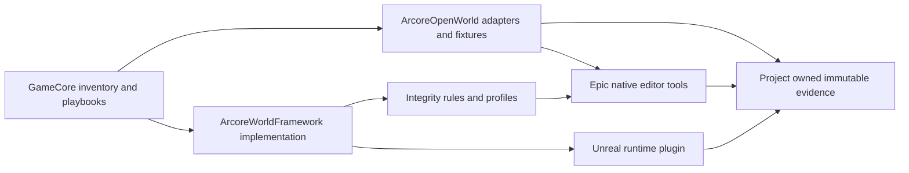

# Unreal framework integration and inventory

GameCore now catalogs the Unreal foundation demonstrated by ArcoreOpenWorld and maintained in the sibling ArcoreWorldFramework package. Use this guide to locate implementation, select validation, and carry reusable mechanisms into another project. The integration is an inventory and documented dependency boundary: implementation stays in its owning checkout, and game assets and evidence stay with the consuming project.

Reviewed on 2026-11-02 for **3D, Windows Win64, Unreal Engine 5.8.4**, changelist 58902052, and **ArcoreWorldFramework 0.1.0**. The installed `Engine/Build/Build.version`, framework `pyproject.toml`, project `.uproject`, and `Config/ArcoreFramework.json` establish these versions. Neither external source directory is a Git checkout. Per-file SHA-256 and aggregate source snapshot hashes in the inventory supply the reviewed baseline; the accompanying [audit record](inventory/unreal-audit.json) records the GameCore revision and checks.

## Where to start

- [Complete file inventory](inventory/UNREAL_FILES.md): every included procedural script, native editor adapter, runtime component, test, profile and guide, grouped by responsibility.
- [Machine-readable inventory](inventory/unreal-inventory.json): source paths, hashes, sizes, Python imports, declared command-line arguments, test names and registered native MCP operations.
- [Validation suite registry](inventory/unreal-validation-suites.json): entry points, prerequisites, side effects, expected evidence and current audit outcomes.
- [Inventory scope and exceptions](inventory/unreal-sources.json): external roots, included trees, selected receipts, exclusions and known operational limits.
- [Procedural and model validation runbook](UNREAL_VALIDATION.md): order of operations, exact example commands, evidence boundaries and historical fixture caveats.

The GameCore-relative source roots are `../ArcoreWorldFramework` and `../ArcoreOpenWorld`. Generated source links assume this sibling layout. Missing sources make the inventory check fail; relocating a checkout requires updating the scope configuration and reviewing the new baseline. GameCore does not install an Unreal plugin, change project configuration or stage runtime profiles when generating this inventory.

## Reuse boundaries

| Capability | Authoritative implementation | Consumer responsibilities and limits |
|---|---|---|
| Source integrity and classified findings | Framework `src/arcore_world_framework/integrity.py`, `profiles/quality_rules.v1.json` | Supply source paths and asset-role contracts. Empty exports, invalid indices and known broken solids block import. Coverage is bounded by implemented rules. |
| Blender portability and procedural geometry | Framework `assets/blender_portability.py`, `geometry/blender_palm.py` | Preserve donor sources, pack required images in derivatives, round-trip the actual GLB and FBX, retain failed exports. Blender is required for Blender operations. |
| Native Unreal asset validation | Framework `adapters/unreal_validation.py` and `adapters/prepared_static_import.py` | Project `asset_quality.py`, prepared batch registry and native toolset supply paths and identities. Read-only fresh-process verification follows saved imports. |
| Godot and ModelForge cross-checks | Framework `workflows/godot_import_probe.gd` and `workflows/modelforge_validation.py` | Project `run_godot_asset_validation.py` and `validate_modelforge_assets.py` provide manifests and existing bridge context. Import success does not validate behavior or appearance parity. |
| Runtime telemetry and render profiles | Framework `Unreal/ArcoreFrameworkRuntime`, versioned profile JSON | Project selects profile, stages files and pins hashes; controller/menu/route remain project-owned. Fast review changes lighting and shadow quality. |
| Angular capture | Framework `Public/ArcoreAngularCapture.h`; consumer `ArcoreSandbox.cpp` | Passive buffered measurements with asynchronous thread/GPU timings. The consumer owns ring layout, sweep camera, warm-up and evidence metadata. |
| Terrain and creek preparation | Framework `terrain/creeks.py`; consumer terrain builders, native C++ Landscape library and creek adapter | Current helper assumes 2017 samples across 8 km. Preserve authored Landscape, named edit layers, original sources and synchronized runtime heights. Not a portable hydrology solver. |
| PCG jungle and palm forest | Project `prepare_*`, `build_jungle.py`, `build_palm_forest.py`, `jungle_graph_program.py`, `palm_forest.py` | Reusable workflow; current scripts contain fixed regions, graph/volume names and masks. Keep graph parameters wired and creek exclusions intact. Placement-origin checks do not establish canopy or collision clearance. |
| Model review and evidence | Project `model_review.py`, capture/export helpers, review runtime and Slate UI | Immutable source/version/profile pins and append-only decisions. Static review proxies do not replace original rigs or prove mechanics. |
| Asset sandbox | Project `build_asset_sandbox.py`, manifests, `ArcoreSandbox*`, launcher | Separate static-mesh fixture; refuses map replacement. Grid and ring manifests have different purposes. Capacity is not a performance or physics acceptance result. |
| Live review tests and evidence verifiers | Project `ArcoreReviewTests.cpp`, `ArcoreModelReviewTests.cpp`, `audit_*`, `verify_*` | Preserve isolated test slots. Historical validators depend on exact logs/counts; do not repurpose their results as broad current acceptance. |

## Use the framework in an Unreal project

Follow the source package's `README.md` and `docs/architecture.md`, listed in the file inventory. Keep the reusable Python package and content-free runtime plugin separate from project implementation. Add the framework's `Unreal` directory to `AdditionalPluginDirectories`, enable `ArcoreFrameworkRuntime`, and add the module dependency where used. Provide a project bootstrap that resolves the framework source and rejects a mismatched required version. ArcoreOpenWorld already demonstrates that wiring in `Tools/framework_bootstrap.py` and `Config/ArcoreFramework.json`.

Stage the selected profile JSON for packaging and record its hashes. ArcoreOpenWorld's `Tools/sync_framework.py` copies render and engine-target profiles into `Content/ReviewData/Framework` and writes `framework_pin.json`. It does not move framework implementation into the game. A runtime or packaged game must not depend on sibling development directories.

Use Epic's installed native Unreal MCP with serial calls and schema discovery. The consumer's `Tools/unreal_mcp.py` is a client, not a new server. Its native `ArcoreWorldTools` extension exposes bounded operations; the inventory enumerates the actual registered methods. ModelForge jobs use its existing bridge. This integration adds no transport, arbitrary-code endpoint, installation or global agent configuration.



## Model admission and review

Classifications are `critical_defect`, `minor_defect` and `optimization`; rule outcomes are separately `pass`, `fail`, `not_verified` and `not_applicable`. Inventory/audit check status uses `passed`, `failed`, `blocked` and `not_run`. Confirmed critical source defects block import; required critical behavior that remains unverified blocks promotion. Never turn missing evidence into a pass.

Search editable, licensed library assets before creating replacements. Pin editable source, donor/library version, file identity, license evidence and source hashes. Validate packed dependencies and nonempty geometry in the actual target exports. Preserve rigs, rest pose, weights, clips, failed versions and original gameplay identity. Explicitly adapt normal-map conventions, visibility and materials; Godot scripts and shaders do not transfer by importing meshes.

For prepared opaque static PBR batches, the framework preflight constrains dependency paths, source hashes, destination namespace, geometry counts, shared material identity and required maps. Native import creates review candidates and saves bindings, usage permutations and decreasing LODs. Restart and verify saved assets without repair before rendering controlled fixtures. Production admission still needs separate appearance, animation, collision/physics and scene performance decisions.

## Evidence and known limits

The inventory pins selected existing quality pointers, performance receipts and the NatureDebris batch receipt. These are **historical project evidence**, not newly executed engine checks. A latest pointer may advance; cite the run receipt and its own source/profile/build hashes. The NatureDebris receipt admits five corrected review candidates and explicitly leaves production approval false. Earlier empty-export checks are superseded; keep their negative evidence and the regression that rejects empty geometry.

The performance records cover controlled diagnostic views on one machine, with explicit rendering tradeoffs. They do not establish a route-wide or shipping-build guarantee. `Tools/analyze_review_performance.py` remains blocked for current acceptance by open M2: it reads fixed historical logs/windows and misidentifies current profiles. Inventorying it does not endorse it. Use the source optimization workflow and immutable evidence until that issue is repaired and validated.

The Godot-to-Unreal playbook remains exploratory. Existing Unreal framework work does not demonstrate a completed ShammyVerse port, packaged game, Google ARCore integration, continuous hydrology, autonomous wildlife ecology, or approved physics.

## Refresh and verification

From GameCore, use Python 3.10 or newer. On this machine `python3` resolves to a Windows Store placeholder; the actual checks used the bundled interpreter recorded in the audit.

```powershell
python tools/inventory_unreal.py --check
python tools/validate_workflows.py
python -m unittest discover -s tools/tests -v
```

`--check` reads source text without importing it and fails on added, missing or changed files, source metadata drift and stale generated Markdown. To accept an intentional source change, inspect the diff, update `unreal-sources.json` where needed, run `python tools/inventory_unreal.py`, and rerun `--check`. Regeneration updates inventory JSON and Markdown only; it never executes a project tool. Rerun the affected validation suites and update the audit record when changing a baseline. The file inventory describes implemented declarations; test execution and approval remain separate records.
