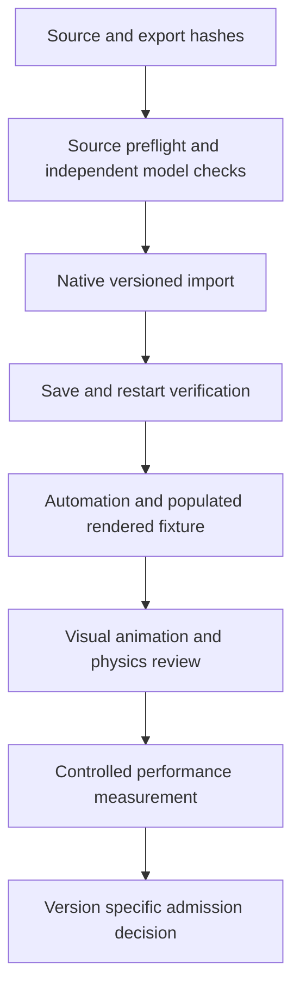

# Unreal procedural and model validation runbook

Use the [integration guide](UNREAL_INTEGRATION.md) to identify the owning checkout. The [suite registry](inventory/unreal-validation-suites.json) lists reproducible entry points and side effects. The [file inventory](inventory/UNREAL_FILES.md) covers all included scripts, including builders and capture helpers that are not standalone tests. This documentation pass runs inventory and Python regressions only; engine examples below are reproduction commands, not claims of new build or playtest results.

## Local regression checks

From GameCore:

```powershell
python tools/inventory_unreal.py --check
python tools/validate_workflows.py
python -m unittest discover -s tools/tests -v
```

From ArcoreWorldFramework:

```powershell
$env:PYTHONPATH = Join-Path (Get-Location) 'src'
python -m unittest discover -s tests -v
```

The framework currently declares seven integrity regressions and eight prepared-import regressions. They check capped versus open/disconnected solids, leaf-card exemption, bad indices, empty scenes, classification separation, dependency and destination containment, hash tampering, conflicting material identity, geometry counts and required portable normal maps. These are Python source/preflight checks, not Unreal or Blender execution. The import fixtures deliberately use fake FBX/image bytes to isolate preflight; native format validation remains a separate gate.

## Procedural world and PCG

From ArcoreOpenWorld, source-data preparation uses Python with `Tools/requirements.txt` dependencies. `generate_terrain.py`, `prepare_jungle.py`, `prepare_palm_forest.py`, `prepare_review_creeks.py` and `prepare_creek_masks.py` create source artifacts. They can write generated files; retaining inputs and choosing an evidence/version destination is part of the work packet. Source generation does not itself reimport an Unreal texture or change an authored Landscape.

`Build-World.ps1` and `build_world.py` create the initial world and deliberately refuse to replace the prototype map. Do not rerun them as a regression against an authored map. `build_review_island.py` and `prepare_review_island.py` belong to the separate model-review fixture. The full list of acquisition, procedural model generation, clip export and fixture preparation tools is in the inventory.

Start or reuse one RHI-capable project editor and discover actual schemas before PCG changes:

```powershell
.\Tools\Start-Editor.ps1
python Tools/discover_pcg_mcp.py
python Tools/build_jungle.py --regenerate
```

The discovery script expects previously saved toolset discovery JSON in `Saved/PCGInspection` as well as a live endpoint. Seed those files through `Tools/unreal_mcp.py` using the native discovery schemas; read `Skill_PCGGraphGeneration.txt`, a shipped reference graph and relevant node schemas before edits. Do not assume the three commands form a clean-room bootstrap. Calls remain serial and local to the existing native server.

`build_jungle.py --regenerate` executes and saves existing PCG; `build_palm_forest.py` and `install_creek_pcg_masks.py` are also mutating operations. Review current manifests and retain mesh/density parameters and creek exclusions. Require nonzero population and zero below-sea, out-of-region, off-ground and reserved-trail origin violations. Preserve `Terrain/jungle_build_report.json`, `pcg_execution_report.json`, palm reports, manifest hashes and runtime population proof. NullRHI cannot establish scene population or terrain-layer rendering.

For creek edits, use the fixed native apply and verify operations. Preserve the named `Arcore_Creek_v002` edit layer, original layer and before/after heightfields; restart the editor and verify saved readback. Keep `Content/ReviewData` height data synchronized. Localized carve checks are not proof of continuous water flow or walkable collision.

## Source and model validation

From ArcoreOpenWorld:

```powershell
python Tools/asset_integrity.py --all
python Tools/validate_modelforge_assets.py
python Tools/run_godot_asset_validation.py
python Tools/model_review.py validate
```

The first three commands write audit reports and latest pointers. Source integrity inspects all project GLBs, including retained historical failures. ModelForge validation uses a pinned bridge context and `save=false`; Godot stages a temporary probe project and invokes the configured native engine. They have external prerequisites and were not run in this integration audit. `model_review.py validate` verifies immutable session pins; it does not capture, import or approve models.

Keep model workflow modes distinct: `model_review.py capture` writes new evidence through ModelForge; `publish --import-meshes` imports and stages a derived runtime index. `review_capture_blender.py`, `prepare_review_materials.py`, `audit_review_proxy.py`, rig inspection and wildlife export tools support those steps. Preserve each model's own compatible rig and clips; evaluated static proxies cannot validate animation or collision.

Unreal native asset audits use the registered `audit_project_assets` operation on `arcore_world_tools.ArcoreWorldTools`. Prepared imports use `process_prepared_asset_batch(batch_id, verify_only=False)` with the registered manifest hash; restart the editor and rerun with `verify_only=True`. Discover current parameter schemas before calls. Preserve exact source/export/manifest hashes, material and texture conventions, actual geometry, saved slot bindings and fresh-process reports. Only the owning batch may be updated; do not scatter review candidates into the adventure scene.

## Build and Unreal automation

From ArcoreOpenWorld, after checking there is no competing project editor or owned preview holding packages:

```powershell
& 'C:\Program Files\Epic Games\UE_5.8\Engine\Build\BatchFiles\Build.bat' ArcoreOpenWorldEditor Win64 Development '-Project=X:\Projects\ArcoreOpenWorld\ArcoreOpenWorld.uproject' -WaitMutex

& 'C:\Program Files\Epic Games\UE_5.8\Engine\Binaries\Win64\UnrealEditor-Cmd.exe' 'X:\Projects\ArcoreOpenWorld\ArcoreOpenWorld.uproject' -unattended -NullRHI -nosound '-ExecCmds=Automation RunTests Arcore.Review' '-TestExit=Automation Test Queue Empty' '-ReportExportPath=X:\Projects\ArcoreOpenWorld\Saved\ReviewQA\Tests' '-abslog=X:\Projects\ArcoreOpenWorld\Saved\Logs\GameCoreReviewTests.log'
```

The source currently declares seven `Arcore.Review` tests:

| Test | What it checks |
|---|---|
| `MapCoordinatesAndHeight` | Coordinate round trip, bounds and bilinear signed-height sampling |
| `NotesPersistAcrossDiskSave` | Notes/settings disk round trip through a unique disposable slot |
| `NatureRouteOnAuthoredTerrain` | Sixteen station route bounds, sea level and original trail alignment |
| `WildlifeMaterialsPersistOnDisk` | Reloaded skeletal material bindings under implemented coverage |
| `PedestalTerrainFootprint` | Sampled pedestal footprint clearance |
| `CreekTerrainPublication` | Prepared localized height edits and runtime publication data |
| `ModelVersionGatesAndJournal` | Version-specific model gates and append-only decision journal behavior |

Keep automation reports and engine logs, record the exact build/content baseline, and inspect errors rather than relying on process exit alone. NullRHI automation does not replace rendered smoke checks, live material permutations or native Landscape restart verification. Production review notes in `ArcoreWorldReview_v1` and `ArcoreReviewIsland_v1` must be preserved.

## Rendered fixtures and sandbox

Build before preview. A representative offscreen review smoke command is:

```powershell
& 'C:\Program Files\Epic Games\UE_5.8\Engine\Binaries\Win64\UnrealEditor-Cmd.exe' 'X:\Projects\ArcoreOpenWorld\ArcoreOpenWorld.uproject' /Game/Maps/Arcore_Prototype -game -DisablePython -ArcoreReviewSmokeTest -RenderOffscreen -windowed -ResX=1600 -ResY=900 -unattended -nosound '-abslog=X:\Projects\ArcoreOpenWorld\Saved\Logs\GameCoreReviewSmoke.log'
```

Require `ARCORE_REVIEW_SMOKE PASS` and `ARCORE_NATURE_WALK_SMOKE PASS`, matched screenshots and no relevant runtime errors. Other opt-in fixtures are `-ArcoreFoundationSmokeTest`, `-ArcoreModelReviewSmokeTest`, `-ArcoreNatureExpansionSmokeTest` and `-ArcoreSandboxSmoke`. Select the matching map and data rather than adding every flag to one run. Nature expansion also emits population, rig, pose and pedestal checks. Stop only the process launched for the test after evidence is complete; some review fixtures continue running rather than exit automatically. Keep only one render process during measurement.

`Tools/build_asset_sandbox.py` runs inside Unreal's Python commandlet, consumes `-SandboxManifest=Assets/Sandbox/layout.v002.json` or a reviewed new manifest, and refuses to overwrite an existing map. It supports version-pinned static meshes in a grid or ring fixture. The grid's smoke checks twenty bays and a nonzero specimen count up to four hundred. This is a static fixture; it does not validate collision, physics, rigging or a four-hundred-object frame budget.

The ring layout additionally supports `-ArcoreSandboxSweep` (or R during review): one warm-up lap and two measured laps at twelve degrees per second. The consumer writes CSV and metadata under `Saved/SandboxCaptures` and logs `ARCORE_SANDBOX_SWEEP`. Asynchronous GPU/thread observations are associated with a previously submitted view, not an exact GPU frame. Preserve capture metadata, resolution, active GPU/RHI, settings and source pins; a completed capture is not a performance acceptance decision.

## Evidence aggregation and performance

`audit_foundation.py`, `verify_foundation_qa.py` and `verify_nature_review.py` are bounded project harnesses. The foundation verifier expects four historical successes; the newer nature verifier expects seven and named log files. Both can write summary reports; the nature verifier also copies evidence into an immutable run. Passing a historical fixture does not certify the current complete project. Rerun corresponding engine fixtures before aggregating their evidence.

Do not use `analyze_review_performance.py` for current acceptance while M2 remains open. It has a fixed log path and station windows and recognizes an obsolete quality label. Consult the framework's optimization best-practice and completion-record workflows, plus the consuming project's optimization log and pinned receipts. Record warm-up, render profile SHA, build/content hashes, population, actual render scale, GPU/RHI, scene windows, frame distribution and severe stalls. Report one-second p95 summaries accurately; their median is not the p95 of the entire run. Keep visual/temporal tradeoffs and route/cooked-platform limits explicit.


