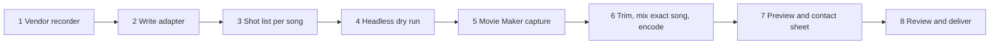

# Make gameplay music videos and trailers

Status: scaffold, built from one production (ShammyVerse, ten songs plus a finale review, November 2026). This is a
reusable playbook for a music video or trailer per song that shows **real gameplay**. The game is driven by script,
captured frame-accurately in engine, and laid over the exact song file with its captions. The runtime is Godot 4
today; another engine needs its own recorder that follows the same markers and contracts.

The [wizard template](wizard.json) is the source of truth for the hub wizard and ArcoreFlow nodes of this workflow.
Its stages are `script_only` until a second game uses them. Read [the worked example](example.md) for the real
commands, timings and lessons.

## Ownership

| Owner | Responsibility |
|---|---|
| GameCore | This workflow, the [Godot recorder base](../../3d/godot/music_video/README.md), [`tools/game_music_video.py`](../../tools/game_music_video.py) and the production record format |
| The game | Its adapter (hero, camera, terrain, captions, HUD), song fixtures and shot lists, and the delivered videos (kept in the game's design folder, not here) |
| Song owner | Exact runtime audio and caption timing (for example, the music-and-lyrics workflow of the game) |
| Requester | Spoiler policy, shot approval, final picture and mix approval |

## Pipeline



Every stage runs again on its own, and nothing is edited by hand in a timeline. A change to a shot, a cut or the mix
is a code change followed by a re-record.

## Production record (fill in first)

Copy this block into the game's music-video folder README. It is the evidence for the delivery.

```yaml
game: <name and repository>
engine: Godot <exact version>              # console executable used for capture
recorder: gamecore.godot.music-video-recorder <version and sha256 from the vendored lock>
resolution: 1920x1200                      # match the game's aspect: no bars, no layout change
fps: 30
songs:                                     # one row per song
  - id: <song id>
    audio: <exact runtime file and sha256>
    captions: <cue source and timing status, e.g. draft ASR alignment>
    setting: <island / level shown>
    spoiler_notes: <what is deliberately not shown>
policy:
  spoilers: <e.g. each song stays in its own setting; no completions, rewards or story reveals>
  hud: hidden except captions
checks:                                    # passed | failed | blocked | not_run
  dry_runs_complete: not_run               # every song finishes headless with no script errors
  blocked_camera_reviewed: not_run         # shots flagged CHECK were looked at
  contact_sheets_reviewed: not_run
  spoiler_review: not_run                  # a person watched every video against the policy
  audio_auditioned: not_run                # song level and effects under it, on speakers and headphones
```

## Procedure

### 1. Vendor the recorder into the game

```powershell
python tools/game_music_video.py vendor --project <game>/game
```

The recorder base is copied to `addons/gamecore_music_video/` with a SHA-256 lock. Never edit the vendored copy.
Change it in GameCore and vendor again; the tool refuses to overwrite local edits unless `--force` is passed.

### 2. Write the game's adapter

The game's recorder script extends the vendored base and overrides the adapter methods listed in the
[runtime README](../../3d/godot/music_video/README.md): load the world with saving disabled, mute the music bus, and
expose the hero, the gameplay camera's yaw/pitch/distance, flight, terrain height, teleport, captions and the HUD
layers to keep.

- **Disable saving first.** Check that the game's save call honours the switch before using any debug fixture.
- **Mute the music bus during capture.** The exact song file is mixed in afterwards. Captions follow the video clock
  through `_update_captions(t)`, so story triggers can never switch tracks mid-video.
- **Turn off camera auto-centring.** The recorder needs to hold its own angles. Movement then follows the camera.

### 3. Write one shot list per song

Each song's `_produce()` sets up its fixture (progress flags, location, companions), calls `start_song()`, hides the
HUD and calls `play_shots(shots, t(), final_shot)`. Shots are short (8.5–16 s by default) and cuts land on caption
starts. Songs without captions are cut about every 15 s.

Build shots from the base library (`stroll`, `run_front`, `jumps`, `takeoff`, `glide`, `low_glide`, `closeup`,
`gaze`, `walk`) plus a few game-specific activities: an ability, a mini-game action, the vehicle. Give every shot
a purpose and its own camera angle (`camera(theta, pitch, distance)`): theta 0 is behind, 90 side-on, 180
facing the camera.

Trailer rules, from the first owner review:

- **No aimless motion.** Long flying in circles was rejected. Flights and walks go straight to a landmark, then cut.
- **Spoiler-light.** Each song stays in its own setting and shows moment-to-moment play. It never shows
  completions, rewards, unlock screens or story reveals. Cap repeated mechanics (for example, two ball whacks per
  video, never the finished objective). Never show the hidden-item location.
- **Vary the second half.** A cycled list repeats. Give long songs enough unique shots or alternate angles.
- **End on a character close-up or a gaze to the horizon**, then the tool fades out.

### 4. Dry run headless

```powershell
python tools/game_music_video.py dry-run --godot <Godot_console.exe> --project <game>/game --script <record.gd> --song <id>
```

A dry run is fast and has no picture. It checks that the song finishes, counts shots, and lists script errors and
shots where the camera guard could not clear the view for more than 20 % of the shot (`CHECK`). Fix every error and
look at every `CHECK` before recording. A whole album dry-runs in minutes.

### 5–7. Record, mix and encode

```powershell
python tools/game_music_video.py record --godot <exe> --project <game>/game --script <record.gd> --song <id> `
  --audio <game>/game/assets/audio/<song>.mp3 --out <game>/Design/music-videos
```

- Movie Maker records at the **window size**. `--resolution` is applied through a temporary `override.cfg`. It is
  shared safely by parallel recordings of the same project and restored afterwards. Use the game's own aspect.
- The capture is trimmed to the `MUSIC_VIDEO_SONG_START` frame. The exact song file is mixed over the recorded game
  effects, with effects at −4 dB, no normalization, and a 1.5 s fade at the end.
- Outputs per song: the full MP4 (H.264 CRF 20, AAC 192 kb/s), a 960×600 sharing preview under 28 MB, a contact
  sheet and a JSON record with the audio hash.
- Rendering is slower than real time (a 4-minute song takes roughly 15–25 minutes at 1920×1200). Two recordings
  can run in parallel on one machine.

### 8. Review and deliver

Look at every contact sheet before sending videos. Typical faults are scenery filling the frame (tune that shot's
angle) and repeats. A person then watches each video against the spoiler policy and listens to the mix. Record the
results in the production record.

## Ambient life and lyrics (recorder 0.3.0–0.6.0)

A world can look deserted behind held shots. With a game that has ambient systems (see the
[ambient-world-life workflow](../ambient-world-life/README.md)), the adapter answers:

- `_stage_ambient("still")` at the start of every held shot: something crosses the background (a pod, a whale, a flock).
- `_stage_ambient("beat")` on every Nth caption start (`stage_beats`).
- `_stage_ambient("lyric:<kind>")` when a caption names something the world can show (`lyric_stage`, for example
  `{"dolphin": "pod", "bubble": "bubbles", "cannon": "salute"}`).
- `_beat_clock(t)`, so dances and drums follow the song in the video.
- `lyric_shots` (0.5.0): `[keyword, Callable(until)]` pairs. A cut whose lines name the keyword plays that shot
  instead of the next list shot, once per pair ("Tiny drums make a tippy-tap sound" → the drums). Unlike
  `lyric_stage`, which drops something into the current shot, this chooses the whole shot. The framing helpers
  (`watch_point`, `hover_watch`, `overview`, `face_yaw`) are in the base, so these shots can track moving life.
- An escort in the game's own vehicle shot (the ShammyVerse dolphin pod rides beside the ship).

After recording, `python tools/game_music_video.py motion <video> --log <recorder log>` flags dead shots, where the
mean frame-to-frame change stays under a threshold.

## Cue list and framing (recorder 0.6.0–0.7.0)

- **Plan before recording.** Write a cue list: one row per shot, starting on its lyric line, naming what the viewer
  sees and which system or ability shows it. Songs without captions cut on musical section changes (the
  ShammyVerse example finds them from loudness and spectral change, snapped to bars). Play it with `play_plan()`.
- **Framing guard.** On by default. Each cut opens on the nearest clear view, and the camera orbits slowly to keep the
  subject unblocked and in frame. Exclude what belongs to the shot (`_occluder_excluded`) and give the guard the
  game's exact camera boom (`_camera_position_for`). Dry-run with `MUSIC_VIDEO_FRAME_DEBUG=1` and fix each
  `MUSIC_VIDEO_BLOCK` cause: a subject point inside a prop (aim above a table top), a shot that starts in water,
  a camera the game lowers into the sand.
- **Foreground clearing (0.7.0).** Props that fill the frame in front of the subject (a giant egg, a palm trunk) are
  hidden for that shot, as a film crew would move them. Games that re-show objects every frame (quest characters)
  need the adapter to hold its own cleared set for a staged moment.

## GPU safety (Windows)

`record` and `showcase` check the System log before starting. If the display driver reset since the last boot
(provider Display, event 4101 or 4109), they stop with exit code 3. A driver that "successfully recovered" can leave
the graphics stack half-working: on the ShammyVerse PC, a timeout during a long capture restarted the desktop
compositor, and later GPU work hung the whole machine. Reboot, then record. `--allow-after-gpu-reset` overrides the
check. Batch scripts should stop on exit code 3, not move on to the next song.

## Delivery variants

- **Story/finale review:** an unedited capture of a scripted sequence at the game's normal camera, using the same
  frame-counted capture. See the finale review in the example.
- **Vertical shorts:** not implemented. Plan 9:16 framing at capture time; cropping 16:10 loses the subject.
- **External visuals (for example, AI-generated title cards or interludes):** not implemented. Place them at chosen
  times with ffmpeg in stage 6 and record their source and license.

## Known limits

- The camera guard swings around blockers but cannot judge composition. The contact-sheet review is required.
- Fixture flags used to reach later areas are the game's responsibility. A fixture that bypasses a rule (for
  example, taking a ship's wheel) should log a warning, as the example does.
- `stages` stay `script_only` until a second game produces videos with the tool unmodified.

## ArcoreCut editing handoff

For retained originals, frame-exact scene splits, working masters and continuous
music/effects mixing, use the sibling ArcoreCut application and the
[video production contract](../../shared/video-production-contract.md). Recorder
0.7.1 adds exact frame markers without changing the shot clock or animation plan.
Keep media under `X:/Projects/GameVideo/<Game>/`; workflow code remains here.
