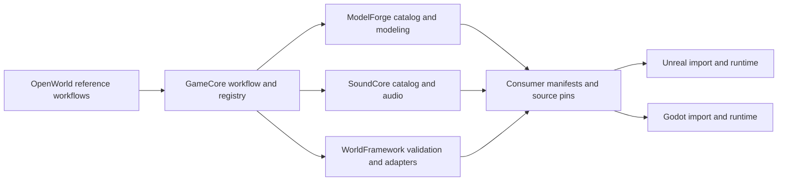

# Connect a game to the Arcore ecosystem

Status: scaffold for 2D or 3D consumers. GameCore is the workflow entry point; each engine owns its runtime. This workflow registers and checks dependencies. It does not convert a game or prove a playable build.

Read [the example](example.md), [the shared contract](../../shared/migration-contract.md), and [the ecosystem registry](../../shared/ecosystem.json). For Unreal asset validation use [the existing inventory](../../framework/UNREAL_INTEGRATION.md).

## Ownership

| Owner | Responsibility |
|---|---|
| GameCore | Workflow selection, integration registry, shared asset contracts and check entry points |
| ArcoreWorldFramework | Reusable integrity rules, geometry, profiles and explicit engine adapters |
| ArcoreOpenWorld | Reference consumer, authored world, PCG context, project fixtures and evidence |
| ArcoreModelForge | Editable models, donor identity, new versions, modeling via its existing MCP |
| ArcoreSoundCore | Source audio, catalog, license metadata, derived assets and collections |
| Consuming game | Engine project, gameplay, asset selections, import adapters, networking and acceptance evidence |

Keep the existing Godot C# autoload/scripts/addons paths operational as they currently stand; the historical template still needs its own build validation. New Unreal runtime modules belong to Unreal projects or the reusable Unreal package. A shared identifier or interchange file does not establish engine behavior parity.

## Procedure

1. Record engine/version/platform, dimension and first playable scope in the consumer's `Config/ArcoreProject.json`.
2. Run `python tools/ecosystem.py --project <consumer>/Config/ArcoreProject.json`. This only checks registered files and consumer declarations. It never starts services, reads credentials, imports modules from other repositories, or executes declared commands.
3. Discover ModelForge's live tools before calls. Search before creating; preserve donor IDs, versions, hashes, license evidence, units, pivot and original sources. ModelForge credentials stay in its local application settings.
4. For SoundCore, use get_capabilities and the applicable project-assets workflow when connected. Search the local catalog as an explicitly labeled fallback. Keep cue IDs separate from source IDs, and preserve original audio and licenses. Unheard candidates remain not-auditioned.
5. Use WorldFramework's prepared import/preflight workflow with a consumer-owned adapter. OpenWorld's paths, map labels and batch-specific native methods cannot simply be called against a different project.
6. Unreal editor operations use Epic's existing native MCP, sequential schema-discovered calls and a project identity check. Godot import checks use its dedicated adapter.
7. Pin actual versions/hashes when admitting an asset or packaging a release. Save engine-specific import, rendering, collision, runtime and packaging evidence separately.

## Completion and future consolidation

A successful checker run establishes file-level integration only. A game still needs build, engine import, playtest and packaging evidence. Live services have separate connectivity checks.

Consolidate reusable OpenWorld tools only after removing project constants and proving them in a second consumer. Keep authored levels/assets and historical evidence in OpenWorld. Do not move directories or combine repositories as part of this workflow. Package runtime dependencies so shipped games do not rely on sibling development checkouts.

## OpenWorld sandbox and walkthrough review

The [review registry](../../shared/review-environments.json) identifies existing entry points, supported observations and exclusions. Run `python tools/ecosystem.py --review asset-sandbox` (or `model-history`, `nature-walk`) to resolve paths without launching a renderer.

Choose a new consumer-owned batch/layout and map name. Pin model versions before comparing them. Preserve existing maps, review saves and failed evidence. Sandbox adaptive stalls use actual static footprints; animated assets need measured motion envelopes. Record individual subjects with the existing close-orbit workflow. Whole-yard sweeps are separate performance diagnostics, and fixed-rate videos are not FPS benchmarks.

Nature Walk is a terrain-following observation camera, not a collision-enabled player. For a strategy game, follow contextual review with top-down readability, selection bounds, navigation clearance, weapon occlusion and dense-army tests in the consuming game. Audio candidates require their own audition, mix and concurrency checks.

The current native import/review adapters contain OpenWorld-specific batch IDs and paths. Registered entry points do not install a consumer adapter or launch unreviewed writes. Extract generic interfaces into WorldFramework only after a second consumer fixture proves them.
