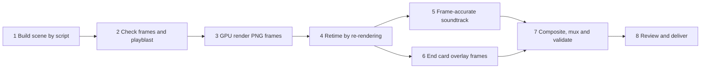

# Produce a logo sting or splash video

Status: scaffold, built from one production (the AreCore V3 Pro 1.5x sting). This is a reusable playbook for a short branded video: an animated 3D logo, a frame-accurate score and sound effects, and a text end card, delivered as a validated MP4. It does not cover playing the video inside a game engine. That needs its own import and playback check (see [Delivery variants](#delivery-variants)).

The [wizard template](wizard.json) is the source of truth for the hub wizard and ArcoreFlow nodes of this workflow; every stage is still `script_only`.

Read [the worked example](example.md) for the real commands, timings and cue sheet. Read [the ecosystem registry](../../shared/ecosystem.json) for where each sibling repository lives.

## Ownership

| Owner | Responsibility |
|---|---|
| GameCore | This workflow, the template, and the production record format |
| ArcoreModelForge | Blender scenes, build scripts, renders and finished videos (under `design/<brand>/`) |
| ArcoreSoundCore | Source foley (CC0/licensed), catalog and license metadata |
| ArcoreSonicAlchemist | SoundFont banks and music tooling used for the score |
| Requester | Brand wording, approval of picture, mix and end-card copy |

Use the brand spelling that matches the audience: **AreCore** for game studio and framework material, **Arcore** for business-side Arcore Platform material.

## Pipeline



Every stage is a script that can run again on its own. Nothing is edited by hand in a timeline, so any change (timing, copy, mix) is a code change followed by a rebuild.

## Production record (fill in first)

Copy this block into the version folder's README before starting. It is the evidence for the delivery.

```yaml
sting_id: <brand>-<version>            # e.g. arecore-v3-pro-1.5x
brand: AreCore | Arcore
source_scene: <path to the .blend this version starts from>
output_folder: <ArcoreModelForge/design/<brand>/<version>/>
resolution: 1920x1080
fps: 24
frames: <first>-<last>                  # and the resulting duration
speed: 1.0 | 1.5 | ...                  # playback speed relative to the source
tools:
  blender: <version>, device <HIP | CUDA | OPTIX | CPU>
  ffmpeg: <version>
  python: <version>, numpy <v>, scipy <v>, tinysoundfont <v>, pillow <v>
sound_sources:
  soundfont: <bank path and license>
  foley: <SoundCore library paths and license>
end_card:
  line_1: <e.g. MADE WITH ARECORE FOUNDRY>
  line_2: <e.g. Game Development Acceleration Framework>
  font: <font file and license>
checks:                                 # passed | failed | blocked | not_run
  frames_complete: not_run
  mp4_validation: not_run
  contact_sheet_reviewed: not_run
  audio_auditioned: not_run             # a person listened on speakers and headphones
  end_card_copy_approved: not_run
```

## Procedure

### 1. Build the scene by script

Write `build_<version>.py`, which opens the previous version's `.blend` (or builds from scratch) and applies this version's changes, then saves a new `.blend`. Keep the earlier version's file untouched so every version can be rebuilt.

- Put every timing value in named constants at the top (for example `DIM`, `IGNITE`, `HERO`, `HOLD_END`, `END`). The soundtrack and end card reuse these frame numbers.
- Key animation every frame with linear interpolation when it is computed procedurally (springs, IK, physics). Blender's default Bezier easing between sparse keys causes overshoot.
- Use light linking to light the hero object or character separately from the stage, rather than raising global light levels.
- Hide area lights from the camera (`visible_camera = False`) and from glossy rays when they show up as reflections.
- Under the AgX view transform, a MIX toward white lifts blacks to grey. Use a MULTIPLY exposure pop for flashes instead.

### 2. Check frames and a playblast

Before a full render:

- Render a few full-resolution check frames at the key beats (an accepted `-- check` argument is a good pattern).
- For motion work, render a fast Workbench playblast and a numeric check (for example the per-frame lowest point, so nothing goes through the floor, and the angular speed of aimed parts, so nothing flips in one frame).
- Aim parts with `rotation_difference` from a fixed axis plus slerp. `to_track_quat` with an up axis flips when the target passes near that axis.

### 3. Render PNG frames on the GPU

Standalone `blender -b scene.blend -a` uses factory preferences and silently renders on the CPU, about 3x slower. Use a render script that:

- enables the GPU backend in `preferences.addons['cycles'].preferences` and sets `scene.cycles.device = 'GPU'`;
- sets `use_overwrite = False` and `use_placeholder = True`, so a crashed render can be started again with the same command and skips finished frames;
- writes `frames/frame_####.png`.

After any scene change, render a complete new sequence. Never mix frames from different scene revisions.

### 4. Retime by re-rendering, not by dropping frames

To change the playback speed, re-render with Blender's time remapping (`render.frame_map_old` and `frame_map_new`; 3 → 2 gives 1.5x) and shorten `frame_end` to match. This samples the animation at even steps with correct motion blur. Speeding up a finished 24 fps video drops frames unevenly (alternating steps of 1 and 2) and judders.

Write down the mapping from source frames to seconds in the new cut. For 1.5x at 24 fps: `t(f) = f / 36 - 1 / 24`. The soundtrack and end card are written against source frame numbers through this function.

### 5. Build the soundtrack frame-accurately

Write `soundtrack.py`, which renders the whole mix offline in Python and writes `soundtrack.wav` (48 kHz stereo) plus `music.wav` and `sfx.wav` stems. It holds no unrendered audio project, so a timing change in step 1 is a constant change here.

1. **Make a cue sheet** from the scene constants (see the template below). Every hit belongs to a frame: take-off, landing, impact, flash, ignition, hero pose, fade start.
2. **Music**: render General MIDI instruments from a SoundFont with `tinysoundfont`, one instrument per call, so each part can be placed, panned and balanced on its own. Pick one key and keep every part in it. Score the story beats: a bed under the action that drops out at the turn, a short motif for the character, and a resolved hit on the logo reveal.
3. **Foley**: decode licensed or CC0 recordings from SoundCore with ffmpeg, pitch-shift by resampling where needed, and pan each one with the object's screen position.
4. **Synthesized layers**: electrical buzz, whooshes, power-down sweeps, risers and hums are easier to synthesize and drive from the same envelopes as the lights than to search for.
5. **Mix and master**: separate reverbs for music and effects, fade with the picture, a gentle soft clip, then normalize to a -1 dBFS peak.
6. **Plot a timeline** (level against time, with cue markers) to check sync visually. This does not replace listening.

### 6. Draw the end card as transparent frames

Write `endcard.py`, which uses Pillow to render one 1920 × 1080 RGBA PNG per frame (`endcard/card_####.png`). Keeping text out of the 3D scene means copy changes take seconds and never need a re-render.

- Start it after the story's payoff, not over the action, and fade it out with the picture.
- Keep it inside the bottom title-safe area, clear of anything moving in the scene.
- Use a licensed font file from the repository. Variable fonts can set the weight per line.
- Animate with eased values: a rule drawing out from the centre, text rising a few pixels, letter spacing settling, a soft shadow for contrast.
- Do not use ffmpeg's `drawtext` filter on Windows. It crashed in fontconfig in this production.

### 7. Composite, mux and validate

Write `finish_<version>.py`, which:

1. fails if any frame or card PNG is missing or zero bytes;
2. overlays the card frames on the scene frames and muxes the soundtrack: H.264 CRF 16, `yuv420p`, AAC 256 kb/s, `+faststart`;
3. writes to a `.pending.mp4` first, checks resolution, frame rate, frame count and audio duration with ffprobe, decodes the whole file with `-xerror`, and only then replaces the final MP4;
4. saves `mp4-validation.json` and a 4 × 4 `final-contact.png`.

### 8. Review and deliver

- Look at the contact sheet and play the MP4 start to finish.
- **A person must listen to the audio** on speakers and on headphones before the audio check is marked passed. A plot is not an audition.
- Update the production record and the version folder README with the commands that produced it.
- Deliver the MP4 with its source: the `.blend`, every script, the stems and the validation files.

## Cue sheet template

| Source frame | Time in cut | Story beat | Music | Effect | Pan |
|---|---|---|---|---|---|
| `<f>` | `t(f)` | e.g. take-off | e.g. pizzicato note | e.g. metal click | e.g. -0.55 |
| ... | ... | ... | ... | ... | ... |

## Delivery variants

Each variant needs its own encode and check. None was produced in the first production.

- **Game engine splash**: Godot 4 plays Ogg Theora (`.ogv`) natively, not MP4, so make a separate encode and test it with `VideoStreamPlayer` on every target platform. Unreal plays MP4 through Media Framework, but codec support varies by platform.
- **Silent loop or GIF**: skip steps 5 and 6, or render the card in.
- **Vertical (9:16) or square**: change the camera and title-safe layout, then re-render. Do not crop the 16:9 frames.

## Known limits

- The first production's sources live under `ArcoreModelForge/design/`, which that repository's git ignores. Back them up or move them into versioned storage before relying on rebuilds.
- Script paths in the first production are absolute Windows paths. Parameterize them before reusing the scripts on another machine.
- A validated MP4 proves the file is well formed. It does not prove the timing, mix or copy are right; those need a person's review.
